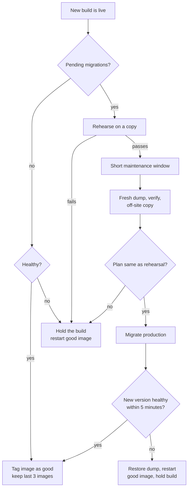

I look after a small business app: ASP.NET Core, EF Core, Postgres, one server. It deploys with Dokploy, a self-hosted platform that builds and runs every push to `main`. That's a nice setup for a small app. It has one hole, and it's the database.

This post is about the guard I built to close it. It's a single script. It backs up, rehearses every migration on a copy, migrates production only after that, and rolls back by itself when something goes wrong.

## The hole

The app never migrates on start. That's on purpose. If a new version finds pending migrations, it refuses to start. In spirit, the check is this:

```csharp
var pending = (await db.Database.GetPendingMigrationsAsync()).ToList();
if (pending.Count > 0)
{
    logger.LogCritical("Refusing to start: {Count} pending migrations", pending.Count);
    Environment.Exit(134);
}
```

Migrating on start is convenient until a migration fails halfway, on production data, while the old version is already stopped. I didn't want that. But refusing to start has its own problem, and one day I hit it:

1. A push with new migrations was built and deployed.
2. The new version refused to start. The orchestrator rolled back to the old one. Fine so far.
3. But there's no image registry, so the platform itself can't roll back on the next deploy.
4. A nightly cleanup deletes old images.
5. And `latest` now pointed at a version that won't start. Any restart would have taken the site down.

So the safe default had turned into a trap. Someone had to run the migration by hand, carefully. I did that once, step by step, and wrote every step down. Then I turned the notes into the guard.

## The manual run

That first manual run took the database from 49 to 62 migrations. The steps:

- Take a dump. Verify it by restoring it somewhere else and comparing a fingerprint of every table's rows.
- Rehearse: restore into a throwaway Postgres, run the 13 migrations there (4 seconds), and check the result.
- Check nothing was written to production since the dump.
- Approve the exact plan. The approval is tied to hashes of the plan, the build, the migration script and the dump, and it expires.
- Migrate production (4 seconds).
- Redeploy without rebuilding, so the build that was checked is the build that goes live.

It worked, and it took a lot of attention for something that should be routine.

## The guard

The guard is one script on a timer that runs every minute, with a lock so two runs never overlap. It doesn't have its own idea of how to back up or migrate. It calls the app's own tools: a backup verifier, a `--migration-plan` flag that prints what would run, and a `--migrate-approved` flag that only runs an approved plan.



### A normal deploy

No pending migrations. Once the new version is healthy, the guard tags its image as `good` and keeps compressed copies of the last three good images, about a gigabyte. That alone fixes the "no registry" problem: there's always a known-good image on disk.

### A deploy with migrations

**Rehearsal, with the site still up.** Dump the database, verify the dump, restore it into a copy, migrate the copy, then start the new version against the copy and wait for it to be healthy.

There's also an "additive" check on the copy. After migrating, no column may be missing and no table may have fewer rows. Both come from `information_schema` and simple counts, compared before and after. A migration that drops data isn't always wrong. But it should never run without a person looking at it.

**The window, about one minute.** Pause the site. Take a fresh dump, verify it, and send a copy off the server. Ask for the migration plan again and compare it with the rehearsal's plan. If they differ, stop: what we rehearsed isn't what we'd run. Then approve, migrate, and start the new version. It has five minutes to become healthy.

**If it fails.** If the migration step ran, restore the database from the dump taken during the window. Keep the failed database under a new name, so I can look at it later. Restart the `good` image. Mark the build as held.

### When the guard holds a build

Some cases shouldn't be fixed by a script:

- The new version crashes with no pending migrations. That's a code bug, not a database problem.
- The migration history in the code doesn't match the database.
- The migration would drop data.

In all three, the guard keeps the old version running and waits for me.

## The edge cases that took the time

The main path was the easy part. The edges took longer.

- **The nightly cleanup.** Old images are deleted late at night. The guard won't start a migration close to that time, so a cleanup can't delete an image it still needs.
- **Settling.** A deploy takes a few seconds to settle. The guard waits 20 seconds before deciding anything.
- **Crashes in the middle.** The guard writes its progress to a small file as it goes. If the server reboots during the window, the next run reads that file and knows exactly what to undo. If a previous run stopped halfway and couldn't recover, the guard refuses to start a new one.
- **Rollback across a schema change.** Rolling back the code after a migration means old code on a new schema. The rollback command refuses and says to `git revert` and deploy forward instead.

## How I tested it

- A dry run on real data: 47 seconds, every one of 121 tables matched after restore.
- A redeploy with no migrations: the guard did nothing, which is right.
- A full rehearsal in a sandbox: 13 migrations applied in about two minutes, end to end.
- A forced failure right after migrating, with a test flag. The guard restored the database and every table came back identical.

The last one is the test I care about most. A rollback you've never seen work is a hope, not a rollback.

## What I learned

**Log lines need to say which database.** The guard logged "database restored" when it restored the throwaway copy. Later, during an unrelated "is data missing?" scare, that line made it look like production had been restored. It hadn't. Now every line names the database it's talking about.

**Use the app's own tools.** The guard doesn't parse migrations or guess at schemas. The app already knows its plan. The guard just asks, compares and records.

**Small setups need this more, not less.** Bigger teams have staging, a registry and someone on call. One server has none of that, so the script has to be the staging and the person on call.

What's still missing: a phone alert when a build is held. Right now I find out when I look.
