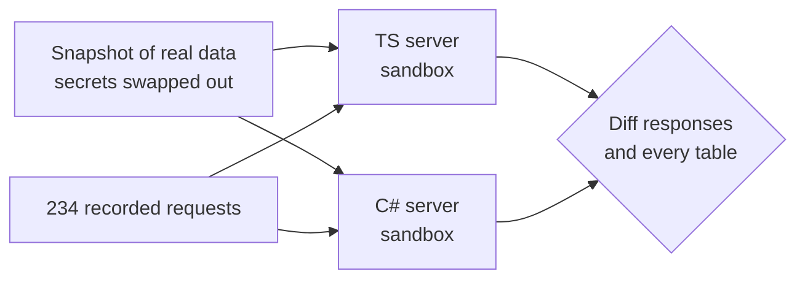

I run a personal agent called Otto. It has a server that holds its tasks, memory, tools and runners. The server was written in TypeScript. I wanted it in C#, mostly because I read C# faster and I wanted the code to be easier to live with.

The rule for the port was simple: nothing outside the server should notice. Same HTTP API, same MCP tools, same events, same SQLite files. The phone app, the runners and the browser extension should keep working without a single change.

I did the port with coding agents. The porting was the easy part. Proving parity was the work.

## The size of it

- The TypeScript server: 57 files, about 15,000 lines.
- About 75 HTTP routes, 95 MCP tools, and about 40 tables.
- The C# server ended up at 78 files, about 29,000 lines. .NET 10, ASP.NET Core, Dapper on the same SQLite files, and the official MCP C# SDK.

The C# is longer. Some of that is C#. Most of it is code that makes C# behave like JavaScript where it matters, which I'll get to.

## How the agents split the work

If you give twelve agents twelve modules and say "port this", you get twelve pieces that don't compile together. So the work went in phases.

**First, one foundation commit.** Shared helpers and the porting rules, written down. The rules were things like: one static class per TypeScript module, copy every prompt and tool description character for character, and don't "improve" anything during the port.

**Second, a signatures pass.** Before any real logic, one pass wrote every module as stubs: types, method signatures, empty bodies. That gave every later agent something real to compile against.

**Third, the port.** 13 port agents and 11 review agents, up to 12 running at once, each in its own git worktree. Each review agent read the C# next to the TypeScript, line by line, and ran both.

One decision saved a lot of pain. Node runs your code on one thread. The TypeScript code assumed that everywhere, without saying so. Instead of adding locks all over the port, the C# server runs the ported logic on a single-threaded synchronization context. Same assumption, same behaviour, no locks.

## Three ways to prove parity

Reviews catch a lot. They don't prove anything. I wanted tests that would fail loudly if the two servers differed.

### 1. The existing checks, pointed at both servers

The TypeScript server already had 29 black-box checks that talk to it over HTTP. I made them run against either server with one environment variable. All 29 pass on the C# server. That's the floor, not the ceiling. Black-box checks only cover what someone thought to check.

### 2. A replay harness

This was the main tool. About 900 lines of JavaScript.



It works like this:

1. Take a snapshot of real data. Replace every token with a fake one of the same shape. Point every outside service at an address that goes nowhere. Swap the CLI tools the server calls for stubs that just log their calls.
2. Start both servers in their own sandbox, on their own copy.
3. Send both the same 234 requests at the same moment: reads, then scripted writes, then a wait of over a minute so background jobs finish, then reads again.
4. Diff every response, then diff every database table by primary key.

The interesting part is the normalization rules. Two correct servers still don't produce identical bytes. Timestamps differ by a few seconds. New UUIDs and tokens are random. "3 minutes ago" can become "4 minutes ago". Each of those got an explicit rule in one list, so I could read exactly what the harness was allowed to ignore.

Two things made me trust the harness itself:

- **A TypeScript-vs-TypeScript baseline.** Run the old server against itself first. If that isn't clean, the rules are wrong, not the port.
- **A `--perturb` flag.** It plants one deliberate change. If the harness doesn't catch it, the harness is broken.

A full run takes about four minutes. The first run matched 217 of 234 requests, and all 37 compared tables were identical. After fixes, 234 of 234.

### 3. Schemas and decisions

Two smaller checks filled gaps. A diff of the MCP `tools/list` output against a capture from the TypeScript server, so tool names, descriptions and argument schemas stayed identical. And a fuzz of the permission rules: 18,994 random steps through both servers, comparing every allow or deny decision. No differences.

## What actually differed

None of these were exotic. All of them would have shipped without the harness.

**Regex `\d` isn't `[0-9]` in .NET.** It matches any Unicode digit, including Arabic-Indic digits. Some of the text Otto handles is Arabic, so this would have changed real matching.

```csharp
Regex.IsMatch("٣", @"^\d$");                            // true in .NET
Regex.IsMatch("٣", @"^\d$", RegexOptions.ECMAScript);   // false, like JavaScript
```

The fix was one small helper so every regex ported from JavaScript keeps JavaScript's ASCII meaning for `\d` and `\w`.

**Rounding.** `Math.Round(2.5)` is `2` in C#. It rounds halves to even. JavaScript's `Math.round(2.5)` is `3`. And `MidpointRounding.AwayFromZero` isn't the same either: JavaScript rounds `-2.5` to `-2`.

**Sorting.** `List<T>.Sort` is unstable. JavaScript's sort is stable. Equal items came back in a different order. LINQ's `OrderBy` is stable, so that's what the port uses.

**JSON.** The output had to match `JSON.stringify` byte for byte: field order, how emoji and some rare characters are escaped, lower-case hex in escapes, `undefined` versus `null`. Parsing too: `JSON.parse` keeps the last of two duplicate keys, and fails on a byte-order mark.

**Error messages.** Clients show some error text to users. Validation errors and network error codes had to read the same.

**A real bug.** One browser tool reads a page and masks secrets before returning it. In the C# version, a call into the browser couldn't return a list the way the code expected, and the masking quietly did nothing. The output looked fine. It just wasn't masked. The replay caught it. A review might not have.

## The cutover

The switch was a small script: `switch.sh cs` or `switch.sh ts`. If the C# server didn't come up healthy, it fell back to TypeScript by itself. After the switch I checked all 96 MCP tools live, both runners, and the app.

Now deploys go through a small C# script that rolls back to the previous build if the health endpoint doesn't answer within 60 seconds. A day later, I deleted the TypeScript server.

## What I'd tell myself before starting

- **Write the rules before the agents start.** "Copy prompts character for character" and "don't improve anything" prevented a whole class of drift.
- **Stubs first.** Parallel agents need something to compile against, or you spend the gain on merge fixes.
- **Keep the old runtime's assumptions.** The single thread is the big one, but rounding, sorting and regexes are the same kind of thing.
- **Test the test.** A clean baseline and a planted bug are what made the 234 of 234 mean something.
- **Make the normalization rules a short, readable list.** Every rule is a place a real difference could hide.

The agents wrote most of the code. What I'm most glad about is the harness, because it's the reason I trust that code.
