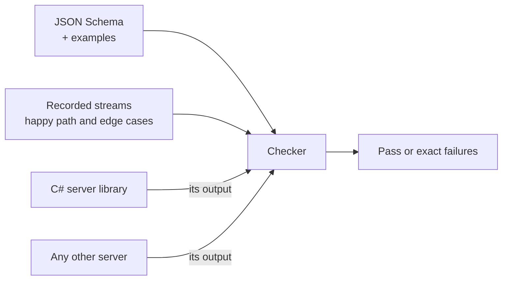

I have four apps with a chat screen. Each one talks to an agent on a server. Each one has its own chat UI, written separately, in SwiftUI.

The bug that made me stop was small. In one app, inline math rendered fine, but display math showed up as raw LaTeX. The other apps had fixed that already, in their own way. That's the pattern: every bug gets fixed once per app, or not at all.

So I'm building one chat UI kit. This post is about the design, before the code. I'm writing it now because the most important decision is already made, and it isn't about UI.

## The decision: the protocol comes first

A chat UI kit has two halves. The views, and the stream of events from the server that the views render. The easy mistake is to treat the events as an implementation detail of the first server you write.

I want the opposite. The contract is a written, versioned JSON Schema, with an example of every event. Not a C# class. Not a Swift struct. The first server library will be in C#, but C# is only the first implementation. It isn't the spec.

I'm borrowing the idea from protocols that do this well. LSP and MCP both have a spec that several languages implement, and that's why editors and agents can mix and match.

## The events

The first version has a short list:

| Event | What it is |
| --- | --- |
| `message` | A complete message from the user or the agent |
| `delta` | A piece of a message that's still streaming |
| `tool_step` | The agent is calling a tool, or a tool finished |
| `card` | Structured content an app can render its own way |
| `ask` | The agent needs an answer from the user |
| `file` | A file attached to the conversation |

They travel as JSON over Server-Sent Events or a WebSocket. A stream for one reply might look like this:

```json
{"type":"message","id":"m1","role":"user","text":"What does softmax do?"}
{"type":"delta","id":"m2","role":"assistant","text":"It turns a list of scores "}
{"type":"delta","id":"m2","text":"into probabilities: $\\sigma(z)_i = e^{z_i}/\\sum_j e^{z_j}$."}
{"type":"message","id":"m2","role":"assistant","done":true}
```

And each event has a schema. A first sketch of `delta`:

```json
{
  "$schema": "https://json-schema.org/draft/2020-12/schema",
  "$id": "https://example.com/chat-protocol/v1/delta.json",
  "title": "delta",
  "type": "object",
  "required": ["type", "id", "text"],
  "properties": {
    "type": { "const": "delta" },
    "id": { "type": "string", "description": "The message this piece belongs to" },
    "role": { "enum": ["user", "assistant"] },
    "text": { "type": "string" }
  },
  "additionalProperties": false
}
```

The details will change. The shape won't: a `type` field, a small set of events, and every field written down.

## Why bother with a schema

Three reasons.

**It forces the hard questions early.** Can a `delta` arrive before its `message`? What happens to an unknown event type: ignore it, or fail? Is math part of the text, or its own event? If the protocol lives in C# code, these questions get answered by accident, by whatever the first implementation happened to do.

**Other languages get types for free.** Tools like quicktype generate types from JSON Schema. A Swift app, a TypeScript client or a Python script can all start from the same file.

**It can be tested without the views.** That's the next part.

## Conformance tests

A spec without tests is a wish. So the kit comes with a conformance kit: recorded event streams, plus a checker.



The checker answers one question: does this server speak the protocol? It validates every event against the schema, and checks the rules a schema can't express. A `delta` for a message that never started. A message that never finishes. Events out of order.

The recorded streams go the other way. They're fixtures for the UI. The kit's gallery can replay any of them, so I can see every message type, including the odd ones, without a server running.

## The kit itself

The UI part is less novel, on purpose:

- **Extract, don't rewrite.** One of the four apps already has the most complete chat. The kit starts as that code, moved into a Swift package, not a fresh design.
- **One configuration.** Theme, feature flags, a slot where an app can register its own card views, and a data source the app provides.
- **A gallery first.** Before any app switches, a gallery shows every event type rendered. Display math included.
- **Its own repo, with versions.** Swift packages want `Package.swift` at the root of a repo, and tagged versions let each app move to a new version when it's ready.

Then the rollout: one app first, with screenshots before and after, then the next.

## The rule I'm keeping

No other languages until someone needs one. The schema makes it possible to add a TypeScript or Python implementation later. That doesn't mean I should write them now. Right now there's one server language and one client language. The spec is there so the third one is cheap, not so I can build it today.

I'll write a follow-up once the kit is in use, with what the schema got right and what I had to change.
