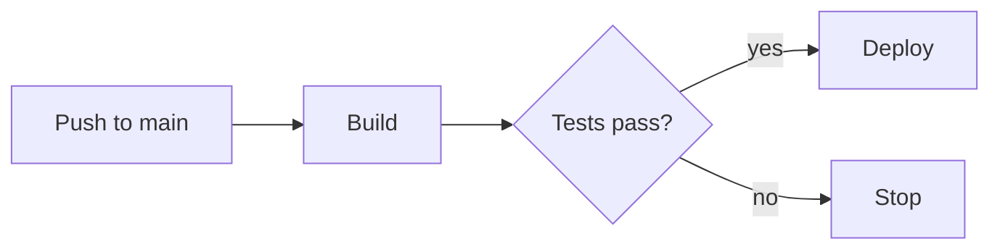
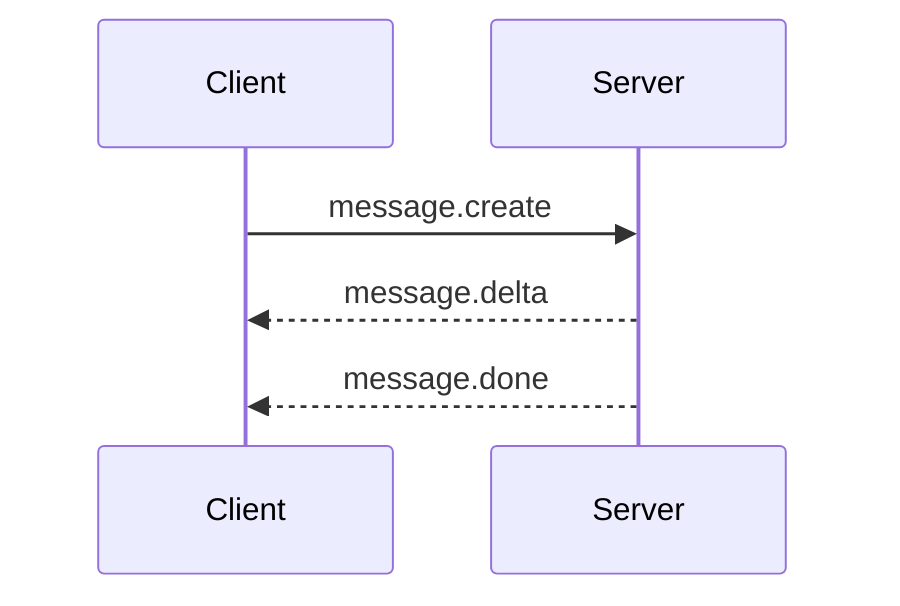

This post never publishes. It exists to test every feature the site supports.

## Text

Plain paragraph with **bold**, *italic*, `inline code` and a [link](https://astro.build). Footnotes work too.[^1]

> A quote, for when someone else said it better.

- A list item
- Another one
  - Nested

1. Ordered
2. List

| Column | Another | Third |
| --- | --- | --- |
| a | b | c |
| longer cell | 42 | true |

## Code

```csharp title="Program.cs" {3}
var builder = WebApplication.CreateBuilder(args);
var app = builder.Build();
app.MapGet("/health", () => Results.Ok(new { status = "ok" }));
app.Run();
```

```ts
type Message = { role: 'user' | 'assistant'; content: string };
export const hello = (m: Message) => `${m.role}: ${m.content}`;
```

```diff lang="json"
 {
-  "version": 1
+  "version": 2
 }
```

```bash
dotnet run deploy.cs -- --dry-run
```

## Math

Inline math: the softmax of $z_i$ is $\sigma(z)_i = e^{z_i} / \sum_j e^{z_j}$.

Display math:

$$
\operatorname{Attention}(Q, K, V) = \operatorname{softmax}\!\left(\frac{QK^\top}{\sqrt{d_k}}\right)V
$$

$$
\begin{aligned}
\mathcal{L}(\theta) &= -\frac{1}{N}\sum_{i=1}^{N} \log p_\theta(y_i \mid x_i) \\
\nabla_\theta \mathcal{L} &= -\frac{1}{N}\sum_{i=1}^{N} \nabla_\theta \log p_\theta(y_i \mid x_i)
\end{aligned}
$$

## Diagram





[^1]: Like this one.
